# iLab Server Monitor

在一个面板中查看茅山王和 SenseCore 的 GPU 资源、训练任务、存储与镜像，创建和管理 ACP 任务，并通过 Terminal 与浏览器内 VS Code 进入工作环境。SSH 管理可接入本机配置的服务器；TokenHub 独立展示余额、实际花费、密钥用量与账号额度。

这是面向个人可信工作空间的工具。当前任务筛选和操作规则围绕显示名称包含 `charles` 的任务设计，接入其他账号时需要同步检查工作空间与筛选逻辑。

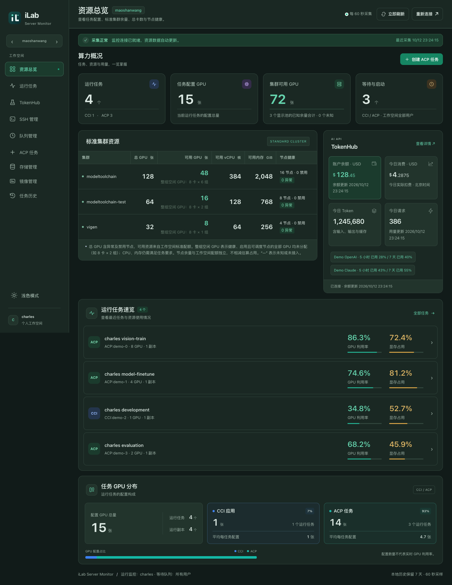

> 截图更新于 2026-10-12，均由当前页面在深色模式下渲染。资源、任务、服务器地址与账户信息使用本地演示数据。

[快速开始](#快速开始) · [页面与功能](#页面与功能) · [效果截图](#效果截图) · [配置](#配置) · [日常使用](#日常使用) · [部署与更新](#部署与更新) · [常见问题](#常见问题)

## 页面与功能

| 页面 | 可以做什么 |
| --- | --- |
| 资源总览 | 查看任务配置卡数、集群可用 GPU / CPU / 内存、节点健康与资源池总量，点击摘要进入对应页面 |
| 运行任务 | 查看个人 CCI / ACP 任务、CPU / GPU / 内存 / 显存曲线、容器日志和任务配置；重命名任务、进入 Terminal 或 CCI 编辑器 |
| SSH 管理 | 检测本机 SSH 配置，展示可连接的服务器、用户与端口；复制登录指令，打开 Terminal 或 VS Code |
| 队列管理 | 查看工作空间内所有用户的等待任务，以及按 GPU 利用率排序的运行中 ACP 任务 |
| ACP 任务 | 读取配置模板、调整资源与启动命令、选择私有镜像，预览后创建；停止、重新启动或释放后重启任务 |
| 存储管理 | 查看 AFS 容量、分区、状态和最近挂载记录，搜索任务与路径、复制挂载路径 |
| 镜像管理 | 按名称、Tag、命名空间和环境版本筛选镜像，复制地址，生成传递与上传命令 |
| 任务历史 | 按类型、状态与关键词筛选结束的任务，查看运行时长、跳转云控制台或重新启动 ACP 任务 |
| TokenHub | 查看 USD 余额、实际消费趋势、API 密钥用量与并发，复制密钥、调整分组、查看账号额度 |

两站点的会话与数据分开管理。侧边栏切换站点，地址参数 `?site=sensecore` 可以直接选择 SenseCore；页面和站点支持浏览器前进、后退。SSH 使用运行服务的电脑上的配置，TokenHub 使用独立账号，两者都不随云站点切换。

界面支持浅色、深色模式，并记住主题选择。手机底部保留总览、运行任务、TokenHub、SSH 和队列入口，其余页面放在“更多”中。顶部“立即刷新”按当前页面刷新数据，并同步显示加载状态。手机存储和历史页将次要筛选收起，显示已选条件数；ACP 优先展示资源输入，模板详情可展开。队列跳转显示数量与当前区域，TokenHub 的低频操作收在“账号操作”菜单。

## 效果截图

桌面截图覆盖上方资源总览及下方八个页面。展开查看任务监控、服务器连接、任务创建与各类资源管理界面。

<details open>
<summary>运行任务 · 任务列表与资源曲线</summary>

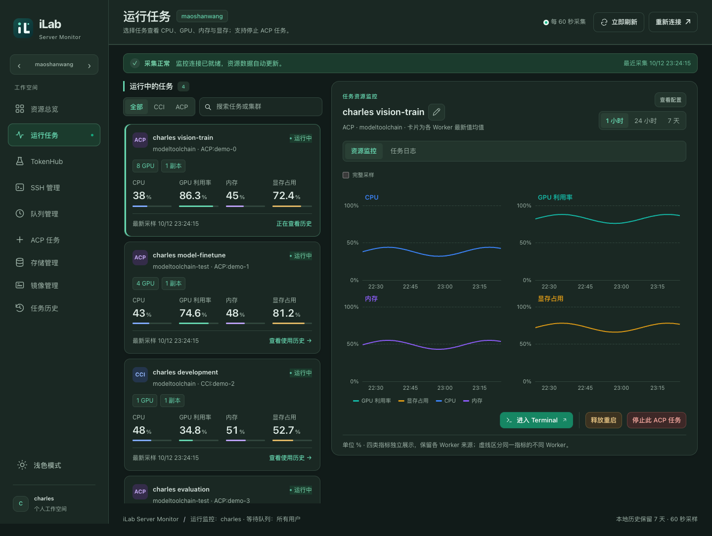

</details>

<details>
<summary>SSH 管理 · 服务器检测与连接入口</summary>

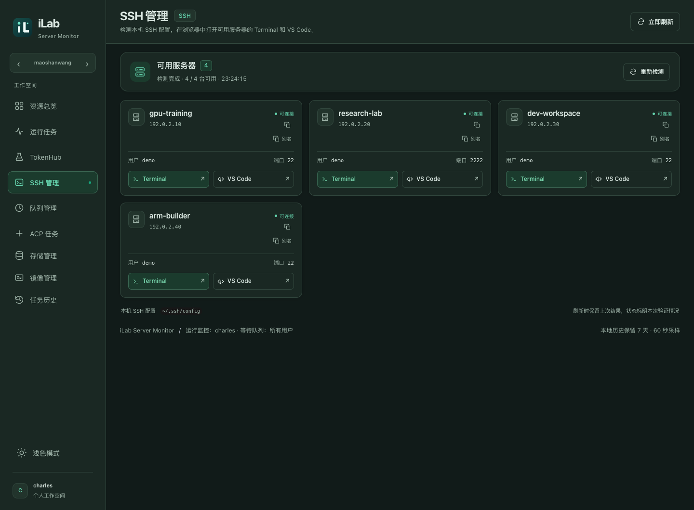

</details>

<details>
<summary>ACP 任务 · 资源、启动命令与镜像配置</summary>

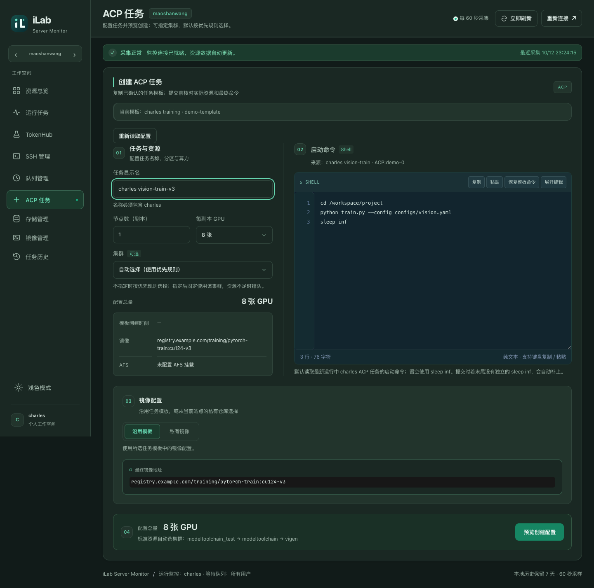

</details>

<details>
<summary>队列管理 · 等待任务与 GPU 利用率</summary>

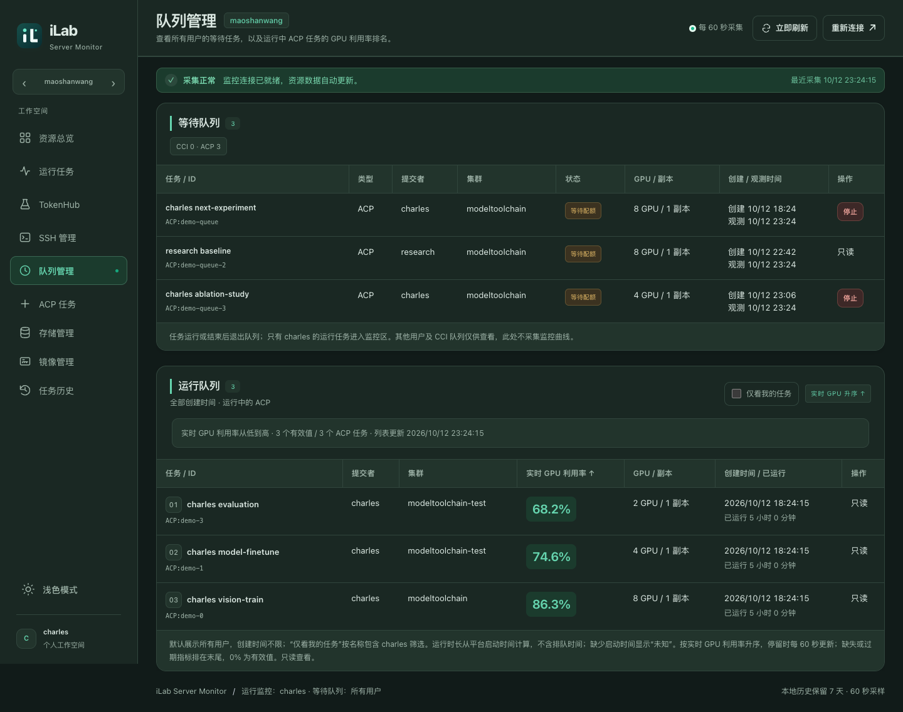

</details>

<details>
<summary>存储管理 · 容量与挂载记录</summary>

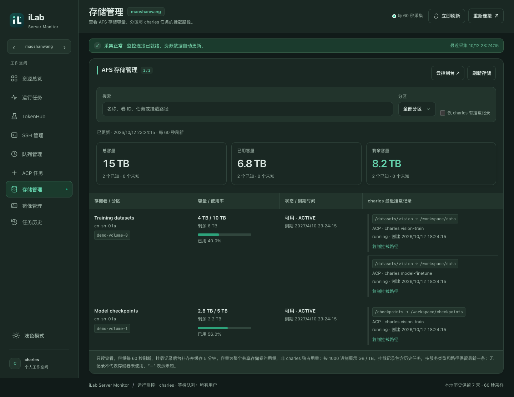

</details>

<details>
<summary>镜像管理 · 仓库与环境版本筛选</summary>

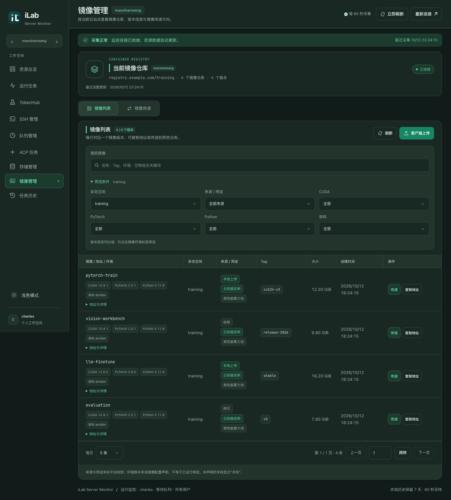

</details>

<details>
<summary>任务历史 · 状态筛选与运行记录</summary>

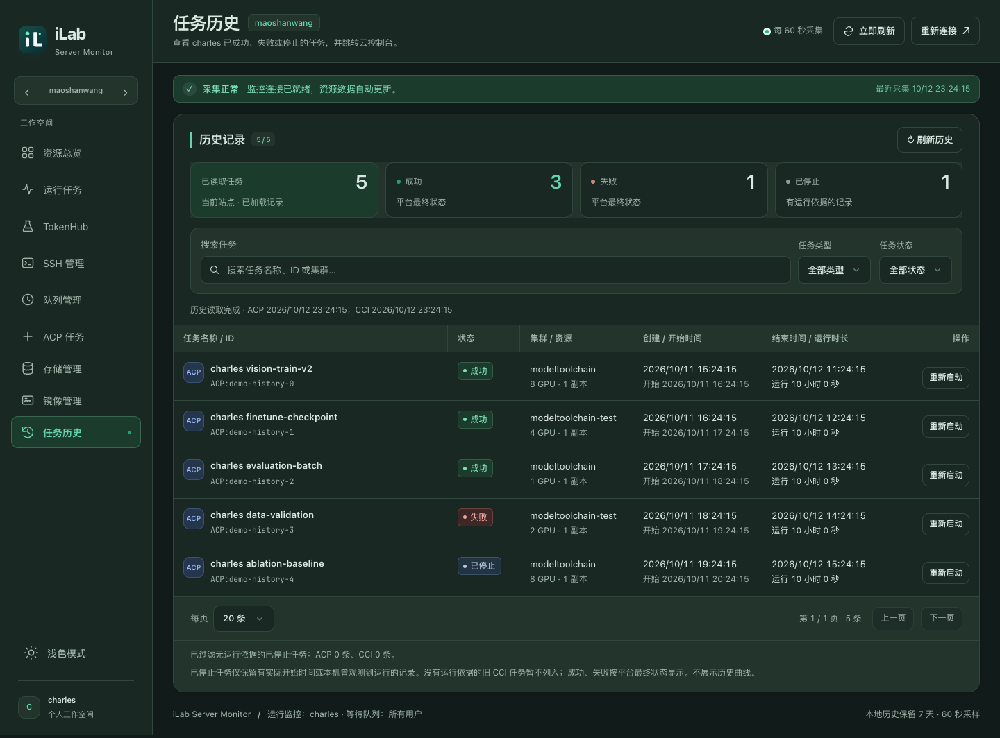

</details>

<details>
<summary>TokenHub · 余额、消费趋势与账号额度</summary>

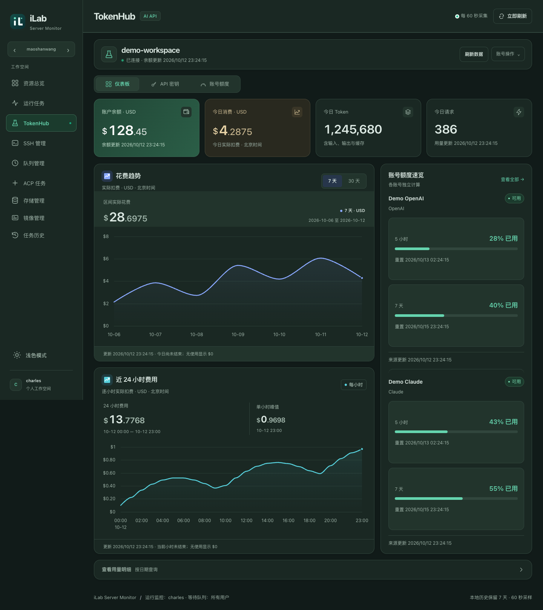

</details>

手机端深色模式首屏，依次为运行任务、存储管理与 TokenHub。

<p>
  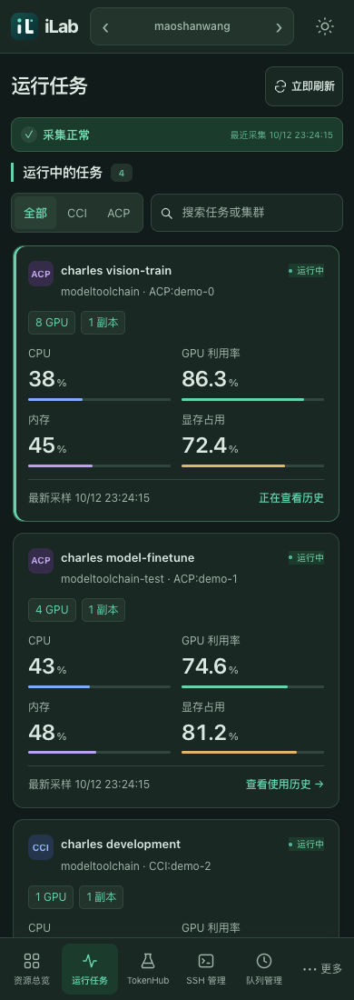
  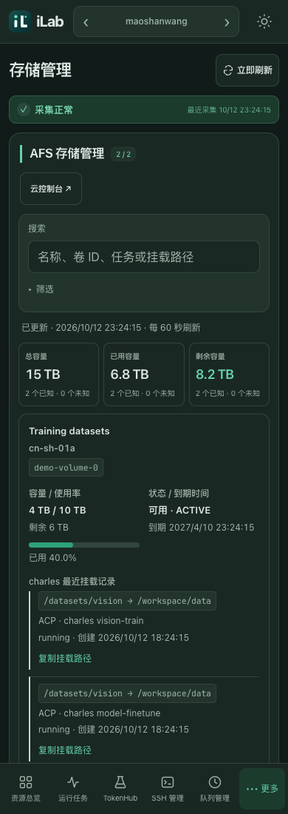
  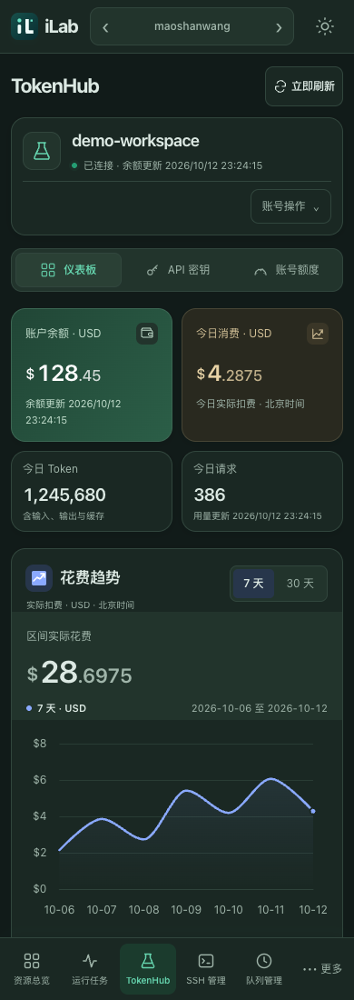
</p>

## 快速开始

需要 Python 3.9 或更高版本、Git，以及可访问云平台的网络。运行环境为 macOS 或 Linux；暂不提供 Windows 原生启动脚本。前端静态资源随仓库提供，日常运行不需要 Node.js 或前端构建。

```bash
git clone git@github.com:Charles2530/server_monitor.git
cd server_monitor

# 保留已有配置；仅在缺少 .env 时从示例创建。
test -f .env || cp .env.example .env
chmod 600 .env

./setup.sh
./start.sh
./status.sh
```

按需编辑 `.env` 中两个站点的 IAM 配置，然后访问 <http://127.0.0.1:8766>。首批资源和任务指标需要等待采集完成；页面提示认证失效时，在运行服务的电脑上使用“重新连接”。

`setup.sh` 创建项目内的 `.venv`，按 `requirements.lock` 安装 Python 依赖并准备浏览器。macOS 默认优先使用已安装的 Google Chrome，否则使用 Playwright Chromium。Linux 如缺少浏览器系统库，可执行 `./setup.sh --with-deps`，该选项可能通过 sudo 安装系统依赖。

| 操作 | 命令 |
| --- | --- |
| 后台启动 | `./start.sh` |
| 查看状态 | `./status.sh` |
| 停止本机服务 | `./stop.sh` |
| 前台调试 | `./run.sh`，按 Ctrl+C 退出 |
| 安装或更新 macOS 自动启动副本 | `./deploy.sh` |

**停止本机服务不会停止云端训练任务。** 前台和后台服务不要同时启动。已安装 macOS LaunchAgent 时，启动、状态和停止脚本优先管理该服务；否则使用普通后台进程。

## 配置

完整示例见 [`.env.example`](.env.example)。常用配置如下。

| 变量 | 用途 |
| --- | --- |
| `MONITOR_IAM_TENANT` / `MONITOR_IAM_USERNAME` / `MONITOR_IAM_PASSWORD` | 茅山王 IAM 登录 |
| `SENSECORE_IAM_TENANT` / `SENSECORE_IAM_USERNAME` / `SENSECORE_IAM_PASSWORD` | SenseCore IAM 登录 |
| `MONITOR_INTERVAL` | 后台采集间隔，默认 60 秒，最小 30 秒 |
| `MONITOR_BROWSER_CHANNEL` | 认证浏览器选择，默认 `auto` |
| `MONITOR_WORKSPACE` | 按需覆盖茅山王工作空间 |
| `MONITOR_CCI_IDE_SSH_HOST` | 茅山王 CCI 编辑器优先使用的 SSH 主机别名 |
| `MONITOR_CCI_IDE_DOWNLOAD_PROXY` / `SENSECORE_CCI_IDE_DOWNLOAD_PROXY` | 对应站点容器内编辑器安装时的下载代理，可选 |
| `DOCKER_REGISTRY_SCRIPT` | 镜像传递命令使用的外部脚本路径，默认 `~/initial/docker/registry.sh` |

此仓库按私有个人仓库维护，现有 `.env` 纳入版本管理，用于可信机器间同步。请保留仓库私有属性；如需公开或分享副本，应先处理配置及 Git 历史中的凭据。登录会话、运行数据库和临时输出保存在忽略版本控制的 `data/` 中。

下载代理只作用于容器内安装过程，不改变日常编辑器流量。镜像页面生成的 `registry.sh` 命令需要在具备对应外部脚本、Docker 和仓库权限的客户端执行，网页不会自动执行上传或传递。

## 日常使用

### 监控、日志与历史

后台默认每 60 秒采集，页面约每 10 秒读取本机快照。手动刷新与自动轮询共享后端刷新逻辑；切换页面会停止不必要的页面刷新，图表按需加载与更新。

运行列表先读取平台“我的应用 / 我的任务”，再按显示名称中包含 `charles` 进行不区分大小写的筛选。等待队列展示所有用户；其他用户任务只读。标准资源汇总忽略 `Public AEC2`。

任务详情支持指标曲线与容器日志。日志可以切换实例和容器、按字面文本搜索并跳到下一处匹配；查找时暂停自动跟随，便于停留阅读。CCI / ACP 任务可在详情中重命名，新名称须保留 `charles`；修改同步到云平台，任务 ID 与历史曲线保持不变。历史页记住当前浏览器会话中各站点的筛选条件。刷新会保留仍存在记录的操作按钮和键盘焦点。

长时间曲线按显示宽度减少绘制点数，保留极值、首尾和采样缺口；勾选“完整采样”可查看全部点。同一任务和时间范围读取失败时保留旧曲线，标明原读取与采样时间；切换任务或范围后不会混用旧结果。存储卷默认只生成最近三条挂载，展开后按批加载其余记录；搜索仍覆盖全部挂载。

理解指标时需要区分以下口径。

- **可用 GPU** 来自资源配额，**总 GPU** 来自节点清单，两者可能不同。
- `0` 表示已知的零值；未知或失败的数据使用“—”等提示，不当作零。
- 超过 5 分钟的采样会提示过期，旧数据不会伪装成刚刚更新。
- 本地指标历史保留 7 天；任务历史页展示结束状态，不提供历史任务的完整曲线。
- AFS 容量属于共享卷，挂载记录包含最近历史记录，不等于当前任务独占空间或全部活跃挂载。

### ACP 创建与重启

1. 选择站点并读取配置，SenseCore 按需选择 AFS 分区。
2. 填写包含 `charles` 的名称，设置节点数、每节点 GPU 数及启动命令。
3. 选择自动匹配或指定兼容集群；镜像可沿用模板，也可按命名空间、镜像仓库与 Tag 选择当前站点的私有镜像。
4. 预览完整配置、最终镜像地址、总卡数和排队提示，核对后提交。

挂载、环境变量等沿用现有任务模板，镜像默认沿用模板，也支持显式替换；目前支持单 `Worker` 角色的可复制模板。总卡数为节点数 × 每节点 GPU 数。资源检查是读取时的快照，不预留资源，最终以云端调度结果为准。

重读配置保留正在编辑的内容；已失效的 GPU 规格会提示重新选择。运行任务的“查看配置”读取目标任务的实际配置，便于核对启动命令与挂载。

停止、重新启动和释放后重启均涉及云端写操作，需要在页面确认。遇到提交结果未知时，先检查原任务或云控制台，避免重复创建。提交命令时，若末尾没有独立的 `sleep inf`，系统会自动补上；脚本结束后容器及其 GPU 资源会继续保留。

### SSH 服务器

在运行服务的电脑上配置 `~/.ssh/config`，进入“SSH 管理”先读取缓存，首次或检测结果超过 60 秒时自动检测，也可手动“重新检测”。扫描期间保留上次可用服务器，并标明验证状态；完成后主列表展示本次登录成功的服务器，未连接的主机和简短原因可展开查看。离开页面或隐藏标签页会暂停前端轮询。支持读取 `Include` 引入的配置；只有通配符的 `Host` 条目不会单独成为服务器入口。

检测使用非交互 SSH 登录。需要先在本机完成密钥或 SSH agent 配置，并确认主机指纹；要求输入密码或确认指纹的主机可能无法通过检测。连接沿用 OpenSSH 配置中的跳板与代理设置。

每张服务器卡片提供 Terminal、VS Code、完整地址复制和本机别名复制入口。完整指令包含用户名、地址和端口；别名指令使用 `ssh <别名>`，可沿用本机配置中的跳板和特定密钥。首次打开 VS Code 会在远端用户目录 `~/.local/share/ilab-cci-editor/` 准备编辑器，支持 Linux x86_64 / ARM64，需有可写目录与下载网络。

### Terminal 与 VS Code

CCI 和 ACP 任务可打开云终端，支持 ANSI 输出、复制粘贴、tmux 会话和手机辅助按键。临时断线时优先恢复仍存活的 Shell；未确认输入不会自动重发。关闭或显式断开终端可能影响其中的前台命令。

桌面端 CCI 任务支持浏览器内 VS Code，由容器内的 code-server 提供。首次打开会准备编辑器，耗时取决于容器网络；已有配置可用于安装 Codex 扩展。茅山王优先使用 SSH，连接或网络认证失败时可回退到云终端通道；明确的认证拒绝和用户取消不会触发回退。SenseCore 默认使用云终端通道，无需为此配置 SSH。

编辑器的 HTTP 与 WebSocket 使用独立转发通道，支持失效检测和有限重试。容器重启、端口变化或后端重启后可能需要重新打开编辑器。

### TokenHub

首次使用时，在运行服务的电脑上点击“连接 TokenHub”，通过弹出的独立浏览器完成 GitHub 登录。TokenHub 会话与两个 GPU 站点独立，切换站点不会切换 TokenHub 账号。

仪表板提供最近 7 / 30 天及最近 24 小时的消费趋势，金额以 USD 展示，并与 token 数量分开。读取失败时保留旧值与原更新时间。密钥列表默认仅显示元数据，点击“复制密钥”时才读取完整值；调整分组需要显式保存。

“断开本机连接”删除本机会话，不撤销 GitHub 授权或远端 API Key。创建密钥等其他账号管理操作仍在原站完成。

## 部署与更新

macOS 需要登录后自动运行时执行以下命令。

```bash
./deploy.sh
```

部署脚本根据机器选择运行配置，将代码与配置复制到 `~/Library/Application Support/CharlesCloudMonitor/`，创建或更新独立虚拟环境，并重启本机 LaunchAgent。现有运行数据与登录会话保留，服务定义位于 `~/Library/LaunchAgents/charles.server-monitor.plist`。

修改源码或拉取更新后，需要再次部署才能更新这个运行副本。也可通过 `./deploy-air.sh`、`./deploy-mini.sh` 明确选择机器配置，详见 [Mac 运行配置](docs/mac-runtime-profiles-1007-1327.md)。需要恢复旧版时，将源码切回已验证的提交后重新部署，并保留运行数据。

Linux 使用普通后台启动；仓库未提供 systemd 安装器。无人登录启动、通知和手机访问按需配置。

| 扩展 | 说明 |
| --- | --- |
| [macOS 无人登录启动](docs/macos-unattended.md) | 机器重启后的常驻服务与登录前运行 |
| [飞书群通知](docs/feishu-notifications.md) | 任务与资源通知配置 |
| [飞书监控看板](docs/feishu-bitable.md) | 同步监控数据到多维表格 |
| [Android 客户端与 Mac 网关](docs/手机客户端与Mac部署交接-1001-1705.md) | Tailscale 私网连接、设备配对和权限管理 |

Android 客户端源码位于 [`mobile/android`](mobile/android)，构建入口为 [`mobile/build_android.sh`](mobile/build_android.sh)。手机网关单独安装，读取与控制权限由配对审批决定；主服务更新后，网关接口变更也需要同步更新。

## 项目结构与开发

```text
server/             FastAPI、站点采集、存储与任务操作、终端和编辑器代理
static/             原生 JavaScript、页面样式与随仓库提供的前端依赖
scripts/            安装、部署、认证和运维辅助脚本
config/             机器运行配置
mobile/             Android 客户端与私网连接组件
docs/               部署说明、功能记录与演示截图
data/               本机数据库、会话与运行输出，不入库
```

后端使用 FastAPI、HTTPX、SQLite 和 Playwright，前端使用原生 JavaScript、ECharts 和 xterm。主面板使用项目自身样式，Terminal / 编辑器入口仍使用部分 Tabler 样式。

常用只读接口包括 `/api/state`、`/api/history`、`/api/task-history`、`/api/storage`、`/api/images`、`/api/utilization-queue` 和 `/api/ssh`。云资源接口通过 `X-Monitor-Site` 选择站点；SSH 清单来自本机配置，TokenHub 使用独立接口与会话。服务默认监听回环地址，API 面向本机界面与受限手机网关，不提供公开多租户服务或 Swagger 页面。

完整本地开发工作区包含 Python、Node 和浏览器回归测试，测试源码按当前仓库策略不上传 GitHub。具备本地测试目录时可运行 `.venv/bin/python -m pytest tests -q`；仅克隆仓库时可先做基础语法检查。

```bash
.venv/bin/python -m compileall -q server scripts
# 可选，需要本机安装 Node.js。
for file in static/*.js; do node --check "$file" || exit; done
```

## 常见问题

**页面没有任务，但云控制台有任务？** 先核对站点、工作空间和任务名称筛选，再查看采集状态。等待任务和运行任务使用不同接口；只有名称符合个人规则的任务进入运行列表。

**点击刷新后数字没有变化？** 界面读取的是云平台最新可用数据。检查采集时间、数据过期提示和来源状态；曲线也受上游采样频率影响。

**编辑器打不开？** 确认 CCI 实例仍在运行。茅山王检查 SSH 配置和云终端登录态，SenseCore 检查云终端登录态；首次安装失败时检查容器下载网络及可选下载代理。

**SSH 管理中没有服务器？** 检查运行服务的电脑上的 `~/.ssh/config` 是否包含具体 `Host` 别名，以及该电脑能否非交互登录目标。切换网络、加载 SSH 密钥或调整跳板配置后，点击“重新检测”；SSH 管理中的 VS Code 还要求远端为受支持的 Linux 系统。

**修改代码后页面还是旧版？** 确认当前运行的是项目目录还是 macOS 部署副本。使用部署副本时重新执行 `./deploy.sh`；普通后台运行时通过停止、启动脚本重启。

**手机可以查看但不能操作？** 检查配对设备是否具备控制权限，以及主服务和手机网关是否同步更新。

前端第三方依赖的许可随静态资源保存，见 [`static/vendor`](static/vendor) 中的 Tabler、ECharts、xterm 及 fit addon 许可文件。
